<a href="https://www.ozkanozcan.com/">
  <picture>
    <source media="(prefers-color-scheme: dark)" srcset="https://raw.githubusercontent.com/ozkanozcan/ozkanozcan/main/dark_mode.svg">
    
  </picture>
</a>

<a href="https://www.ozkanozcan.com/"><picture><source media="(prefers-color-scheme: dark)" srcset="https://raw.githubusercontent.com/ozkanozcan/ozkanozcan/main/link_1_dark.svg"></picture></a><a href="https://x.com/ozkanozcan"><picture><source media="(prefers-color-scheme: dark)" srcset="https://raw.githubusercontent.com/ozkanozcan/ozkanozcan/main/link_2_dark.svg"></picture></a><a href="mailto:ozkanozcan@gmail.com"><picture><source media="(prefers-color-scheme: dark)" srcset="https://raw.githubusercontent.com/ozkanozcan/ozkanozcan/main/link_3_dark.svg"></picture></a>

<picture>
  <source media="(prefers-color-scheme: dark)" srcset="https://raw.githubusercontent.com/ozkanozcan/ozkanozcan/main/pacman_dark.svg">
  
</picture>
